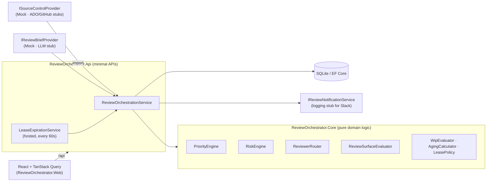

# ReviewHub — PR Review Orchestrator (PoC)

## What this is

AI-assisted coding has made it cheap to open pull requests, but human review capacity hasn't grown with it. PRs get buried in notifications, authors keep opening more, and review latency ends up dominated by **queue time** rather than review time.

This proof of concept adds a thin **orchestration layer** on top of an existing source-control platform (Azure DevOps / GitHub). It does not replace either one. It makes review work explicit and answers four questions at a glance:

1. **What should be reviewed next?** A deterministic priority score, with the reasons shown.
2. **Who should review it?** Routing by ownership, specialty and current load, with reviewer leases.
3. **What actually needs human attention?** A review brief from a pluggable provider (deterministic mock here) and a recommended file order.
4. **What is going stale or blocked?** Aging states, large-review-surface warnings and author WIP signals.

Everything runs locally with seeded demo data. No credentials are needed.

## Architecture



| Project | Responsibility |
|---|---|
| `src/ReviewOrchestrator.Core` | Domain model, options, provider interfaces, and every scoring/routing rule (no I/O, no EF). |
| `src/ReviewOrchestrator.Infrastructure` | EF Core + SQLite, mock source-control and brief providers, provider stubs, logging notifications, the orchestration application service, the lease background service, seed data. |
| `src/ReviewOrchestrator.Api` | Minimal API endpoints (thin), Problem Details error mapping, DI and configuration. |
| `src/ReviewOrchestrator.Web` | Vite + React 19 + TypeScript + Tailwind v4 + React Router + TanStack Query + Lucide. |
| `tests/ReviewOrchestrator.Core.Tests` | xUnit: priority, risk, routing, review surface, aging/WIP, lease rules, and workflow/lease-rerouting tests against in-memory SQLite. |

## Running locally

Prerequisites: **.NET 10 SDK** and **Node.js 20+**.

The schema is created automatically on startup (`EnsureCreated`, no migrations step), and the database is **reset and re-seeded on every start** so the demo timestamps ("47m waiting") stay fresh. Set `Database:ResetOnStartup=false` to keep state between runs.

```bash
# backend → http://localhost:5080
dotnet restore
dotnet run --project src/ReviewOrchestrator.Api
```

```bash
# frontend → http://localhost:5173 (proxies /api to :5080)
cd src/ReviewOrchestrator.Web
npm install
npm run dev
```

Open http://localhost:5173.

Tests and type checks:

```bash
dotnet test
cd src/ReviewOrchestrator.Web && npm run typecheck   # or: npm run build
```

### Docker Compose

```bash
docker compose up --build
# UI  → http://localhost:8080
# API → http://localhost:5080/api/health
```

## Demo flow

1. Open the application.
2. The review queue is already populated (15 open PRs plus one approved PR used for metrics).
3. High-priority and aging PRs sit at the top: #183 (production fix, high risk, stale) and #219 (release blocker).
4. Select **Add pending skill lifecycle handling** (#217).
5. Read the **AI Review Brief**: *What changed*, *Worth human attention*, *Mostly mechanical*.
6. See **Why this is ranked highly** (`+25 blocks other work`, `+10 medium-risk area`, …) and the **Risk Assessment** (Medium: persistence, API contract and backend changes; no auth changes).
7. See the **Recommended review order**: `PendingSkillCoordinator.cs` first.
8. See the **Review Assignment**. #217 goes to Bob Smith because he owns the component and has the lowest load. Kent Jones also owns it but is at capacity (3/3), so he shows as a non-eligible candidate. Alex's **review pipeline load** warning shows 4 open PRs.
9. Click **Start Review**.
10. The status changes to **In Review** in the header and the queue.
11. Click **Approve**.
12. The PR leaves the open queue (pick *Approved* in the status filter to see it again).
13. The sidebar counts, *Assigned to Me* and **Analytics** update. No browser refresh is needed.

Other things to try:

- **Request Changes** on #212, or **Release** on #198 and watch it reroute to the next eligible reviewer.
- **#214** and **#198** show the *Large review surface* warning (lock files and snapshots excluded).
- **#205** was written by Priya, the main auth specialist, so the High-risk rule routes it to Elena, the other security specialist.
- **Lease expiry:** PR #190 is seeded with an assignment whose lease ran out 30 minutes ago. The background service expires it at startup and reroutes it (see `ReviewerLeaseExpired` in the API log). On any PR that is *Assigned* but not started, use `⋯` → **Simulate lease expiry** to watch the reroute.
- `⋯` → **Recalculate** recomputes risk, priority, candidates and the brief.
- Try to start #183 "as" Kent Jones: he is at capacity, so you get a 409 Problem Details and an error toast.

## API

| Method | Route | Notes |
|---|---|---|
| GET | `/api/review-queue` | `repository, priority, risk, status, reviewerId, authorId, agingState, search, sort`. Defaults: open statuses, `sort=priority-desc`. `status=all` and `agingState=attention` (Aging + Stale + Critical) are shortcuts. Sorts: `priority-desc, oldest, newest, smallest, largest, risk-desc`. Summary counts ignore the tab filters (priority / aging). |
| GET | `/api/pull-requests/{id}` | Metadata, priority and risk explanations, assignments, top-3 candidates, brief, files, WIP and review-surface warnings. |
| POST | `/api/pull-requests/{id}/start-review` | `{ "reviewerId": "guid" }` |
| POST | `/api/pull-requests/{id}/release-review` | Releases the assignment and reroutes (the releasing reviewer is excluded). |
| POST | `/api/pull-requests/{id}/complete-review` | `{ "outcome": "Approved" \| "ChangesRequested" }` |
| POST | `/api/pull-requests/{id}/recalculate` | Risk, priority, candidates, brief. |
| POST | `/api/pull-requests/{id}/simulate-lease-expiry` | Demo helper. |
| GET | `/api/reviewers` | Load, capacity, components, specialties. |
| GET | `/api/metrics/summary` | Queue metrics, reviewer utilization, aging buckets. |
| GET | `/api/me` | Fixed demo identity (Bob Smith). |

Errors are RFC 7807 Problem Details: 404 (PR not found), 400 (invalid outcome / filter), 409 (already in review by someone else, reviewer at capacity, reviewer is the author, no active assignment).

## Configuration

All settings live in `src/ReviewOrchestrator.Api/appsettings.json` and can be overridden with environment variables (`ReviewRouting__DefaultLeaseHours=2`, …).

| Key | Default |
|---|---|
| `ReviewRouting:DefaultLeaseHours` | 4 |
| `ReviewRouting:MaxAuthorOpenReviewsBeforeWarning` | 3 |
| `ReviewRouting:LeaseCheckIntervalSeconds` | 60 |
| `Queue:WaitingHours` / `AgingHours` / `StaleHours` / `CriticalHours` | 4 / 8 / 24 / 48 |
| `Priority:HighBandThreshold` / `MediumBandThreshold` | 35 / 20 |
| `ReviewSurface:MeaningfulLineThreshold` / `ProductionFileThreshold` | 600 / 15 |
| `SourceControl:Provider` | `Mock` (`AzureDevOps`, `GitHub` are stubs) |
| `ReviewBrief:Provider` | `Mock` (`OpenAI` is a stub) |
| `Database:ResetOnStartup` | `true` |

## Architecture decisions

- **The queue is separate from the source-control provider.** Azure DevOps or GitHub stays the source of truth for the PR. The orchestrator owns only what it calculates: priority, risk, aging, assignments and leases, candidate scores and briefs. Providers map their payloads into the internal `PullRequest` model behind `ISourceControlProvider`, so the domain never depends on an SDK type, and a real provider can replace the mock without touching scoring or routing.
- **Priority is deterministic.** Reviewers have to trust the order. Every point in the score comes with a reason the UI shows ("+35 production fix"), the numbers are easy to tune, and the same input always gives the same rank, which also makes it unit-testable.
- **The review brief is provider-based.** `IReviewBriefProvider` separates *what a brief is* from *how it's produced*. The deterministic mock proves the UX without an API key. An LLM implementation can be swapped in by configuration, and the brief is stored, so there's no per-view cost.
- **Reviewer routing is isolated domain logic.** `ReviewerRouter` is a pure function of PR, risk, reviewers and load. It's easy to test (capacity, inactivity, author exclusion, the high-risk specialist rule) and easy to explain ("Why Bob?"). The orchestration service only feeds it state and persists the result.

## Assumptions and PoC simplifications

- **Priority bands** aren't defined in the spec. Here a score ≥ 35 is High and ≥ 20 is Medium, both configurable. With these thresholds #217 lands in High (driven by *blocks other work*), as the spec intends.
- **"Waited > 1 business day"** is treated as ≥ 8 clock hours, and leases use clock hours, as the spec allows.
- **Wait time** is measured from `ReadyForReviewAt`.
- **Active reviews** are assignments in `Assigned` or `Acknowledged`. When scoring candidates for a PR, that PR's own assignment is excluded, so a reviewer is never penalized for the PR they already hold.
- **Authors** are never routed their own PR. Reviewers who released a PR or let its lease expire are excluded when it is rerouted.
- **High-risk PRs** restrict the pick to reviewers whose specialty is `security`, `auth`, `infra` or `database`, or matches a detected risk area. If none has capacity, the router falls back to the best available reviewer and says so in a routing note.
- **Risk heuristics** are path- and label-based. Telemetry-only, docs-only, tests-only and generated-only changes are Low. Test files are never treated as security-sensitive.
- **Starting a review as someone other than the current assignee** is allowed while the assignment is still un-acknowledged; the assignment is handed over. Once a review is acknowledged, others get a 409.
- **Completing a review** (Approve / Request Changes) that was assigned but never explicitly started acknowledges it implicitly.
- **There is no authentication.** "Current user" is a fixed demo identity (Bob Smith), and the UI's *Review as* selector lets you act as any reviewer.
- **Extra fields** beyond the spec model: `PullRequest.LinkedWorkItem`, `PullRequest.LastNotifiedAgingState` (prevents repeat aging notifications) and `Reviewer.RepositoryHistory` (the "+15 has reviewed this repository" mock flag).
- **PR titles and descriptions** are rendered as plain text, never as HTML.

## Future work

- Azure DevOps provider (PR, iterations/changes, reviewer votes, work-item links).
- GitHub provider (pulls, changed files, requested reviewers, CODEOWNERS, labels, checks).
- Real LLM review brief, treating repository content and PR text as untrusted input.
- Slack notifications behind `IReviewNotificationService`, following the policy in [docs/notification-policy.md](docs/notification-policy.md).
- Merge queue integration.
- Historical analytics (time-to-first-review trends, per-team throughput).
- Team-specific priority and routing configuration.
- Real authentication / SSO and a business-hours calendar for leases.
